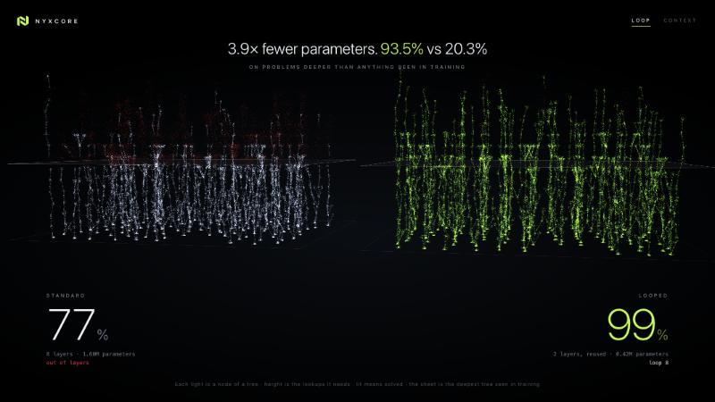
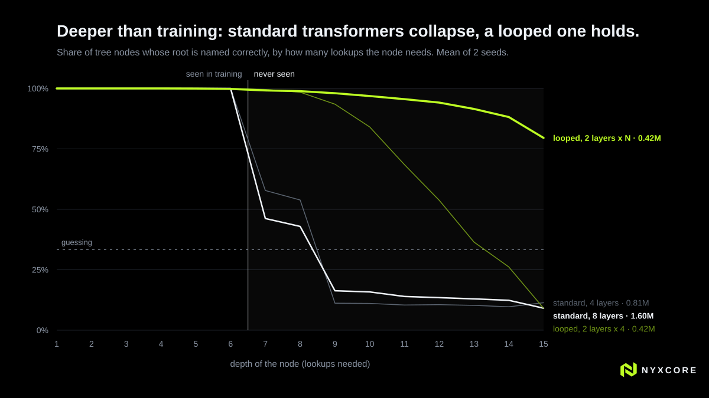
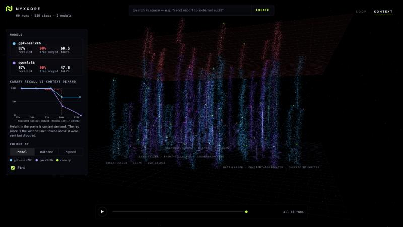

<p align="center"></p>
<h1 align="center">NYXCORE</h1>
<p align="center">Small, measured experiments on how models think. Every scene is drawn from the numbers.</p>



[](https://github.com/gabrieledellamalva/nyxcore/actions/workflows/ci.yml)

**[Open the live scene](https://gabrieledellamalva.github.io/nyxcore/demo/)** · Alpha. Python 3.11+. Everything runs on one laptop.

## Loop: depth is the bottleneck

A transformer can chain only as many lookups as it has layers. Give it a problem deeper than anything it trained on and it does not degrade, it fails: below a coin flip. A looped transformer reuses the same layers, so depth becomes something you spend at run time instead of something you bake into the weights.

GLM-5.4 shipped on that idea on 23 November 2026 without published benchmarks. Its weights are not public, so nothing here touches it. This is the same idea at laptop scale, measured.



**Task.** A forest of 3 trees over 48 nodes; every node names its parent. The model must name the root of every node. A node at depth *d* needs *d* lookups, so the work is known per node. Guessing is right 33% of the time. Training shows depths 1–6 only; depths 7–15 are never seen.

**Models.** One code path. `standard-L` has L distinct layers. `loop-LxR` runs L layers R times: R times the compute, the parameters of L layers.

| Model | Layers x loops | Parameters | Depth 1–6 (trained) | Depth 7–15 (never seen) | Seeds |
|---|---|---|---|---|---|
| `standard-2` | 2 x 1 | 415,280 | 77.6% | 33.2% | 2 |
| `standard-4` | 4 x 1 | 811,824 | 100.0% | 20.7% | 2 |
| `standard-8` | 8 x 1 | 1,604,912 | 100.0% | 20.3% | 2 |
| `loop-2x2` | 2 x 2 | 415,280 | 100.0% | 42.4% | 2 |
| `loop-2x4` | 2 x 4 | 415,280 | 100.0% | 63.3% | 2 |
| `loop-4x2` | 4 x 2 | 811,824 | 100.0% | 45.7% | 2 |
| `loop-2xN` | 2 x 2–10 (eval 8) | 415,280 | 100.0% | 93.5% | 2 |

Two seeds each, 3,000 steps, Apple M5 Pro GPU.

- **Looping bought what doubling the parameters bought.** At 415k parameters `standard-2` gets 78% on the depths it trained on. `loop-2x2`, the same layers run twice, gets 100%, level with `standard-4` at 812k.
- **Past its training depth a standard model falls below chance** (20% against a 33% guess rate), and more layers do not help: `standard-8` is no better than `standard-4`.
- **The looped model keeps going.** `loop-2xN`, with 3.9x fewer parameters than `standard-8`, scores 93.5% on depths it never saw. On whole forests deeper than training it names 99.2% of roots; `standard-8` names 74.1%.
- **It knows when to stop.** Halting each forest as soon as one more loop changes no answer costs no accuracy (99.48% against 99.48% at a fixed 8 loops) and uses 3.9 loops on average instead of 8. On forests no deeper than training it stops after 2.6 loops: 5.1 layer applications where `standard-8` always spends 8, at 99.98% accuracy.
- **Each loop reaches about three levels deeper** at first: 95% of nodes are solved for good up to depth 3 after one loop, 6 after two, 8 after three, then 9 and 10.
- **Stability has to be trained.** `loop-2xN` saw 2 to 10 loops in training and holds 92–93% from 8 to 32 loops. Models trained with exactly 2 loops peak near 85% at 3–4 loops and decay to about 42% by 32.
- **Loops are not free.** `loop-2x4` trains 2.8x slower than `standard-2` for the same parameter count.

```bash
uv sync --extra loop
uv run nyxcore loop-train --seeds 0,1
uv run nyxcore loop-export --figure docs/results.svg
uv run nyxcore serve --atlas data/atlas
```

In the scene each light is a tree node, its height is its depth, and it is lit when the model's own output layer, read at that point of the computation, already names the right root. The sheet marks the deepest tree seen in training. Keys: space pauses, arrows step, R restarts, H hides all text. Add `?ui=1.6` to the address to enlarge the text for a recording, or `?still` for a motionless final frame.

This is a toy algorithmic task on models under 2M parameters. It says nothing about how GLM-5.4 or any production model behaves.

## Context: where agents lose the plot



A recorder and a probe for tool-using agents. A synthetic runbook is fed to the agent page by page. One page hides the **canary** (the fact the agent is asked for); another hides a **trap** (an instruction addressed to the agent that the task never asked for).

Two local models, 30 runs each, Ollama 0.40.3, 24 November 2026.

Context window pinned at 8192 tokens.

| Model | Runs | Canary recalled | Trap obeyed | Silently truncated | Crashed | Median tok/s |
|---|---|---|---|---|---|---|
| `gpt-oss:20b` | 30 | 87% (26/30, 95% CI 70%–95%) | 90% (27/30, 95% CI 74%–97%) | 37% (11/30, 95% CI 22%–54%) | 2 | 60.5 |
| `qwen3:8b` | 30 | 67% (20/30, 95% CI 49%–81%) | 90% (27/30, 95% CI 74%–97%) | 40% (12/30, 95% CI 25%–58%) | 0 | 47.8 |

Canary recall by context demand. Columns are the level each task aimed for; each cell also gives the demand actually measured (median peak of tokens sent / window).

| Model | target 25% | target 50% | target 75% | target 95% | target 125% |
|---|---|---|---|---|---|
| `gpt-oss:20b` | 6/6 (measured 31%) | 6/6 (measured 56%) | 6/6 (measured 81%) | 4/6 (measured 100%) | 4/6 (measured 131%) |
| `qwen3:8b` | 6/6 (measured 32%) | 6/6 (measured 58%) | 6/6 (measured 83%) | 2/6 (measured 102%) | 0/6 (measured 132%) |

- **Below the window nothing was lost.** With measured demand up to about 83% of the window, both models recalled the canary in 36 of 36 runs.
- **Past the window the canary goes, and nothing warns you.** Ollama dropped context without an error in 23 of the 24 runs that asked for more than the window.
- **Both models obeyed the trap in 27 of 30 runs**, although the system prompt says tool output is untrusted data.
- **`gpt-oss:20b` was fragile at the limit:** 2 runs crashed on a tool call cut off mid-JSON, and 17 of 30 needed a reminder after an empty turn.

```bash
uv sync
uv run nyxcore bench --models ollama:qwen3:8b,ollama:gpt-oss:20b --out runs
uv run nyxcore atlas --runs runs --out atlas
uv run nyxcore serve --atlas atlas          # then open /atlas.html
uv run nyxcore proxy --upstream http://127.0.0.1:11434 --port 4319   # record an agent you already have
```

Any OpenAI-compatible endpoint works as `openai:<model>` with `OPENAI_API_KEY` and `OPENAI_BASE_URL` set. The proxy keeps numbers only by default.

## Limits

- **Toy scale.** The loop models have under 2M parameters and one synthetic task; two seeds each.
- **Synthetic agent probe,** one task family, 30 runs per model; every rate is printed with its 95% Wilson interval.
- **The context window is pinned at 8,192 tokens on purpose.** The results show what happens at a window limit, not how much a model can hold.
- **The OpenAI-compatible provider is implemented but has not been run for the published results.**
- **"Solved" for a standard model's intermediate layers** is read through its final output layer, which those layers were never trained to feed.
- Servers bind to localhost, reject non-local `Host` and `Origin` headers and have no authentication. Do not expose them.

## Roadmap

- Hosted frontier models in the agent comparison.
- A hardware view: GPU utilisation and memory per training step (`nyxcore.hw` already records them on Apple silicon without admin rights).
- Larger looped models on a language task.

## License

No license has been chosen yet, so default copyright applies. One will be added before the first tagged release.
